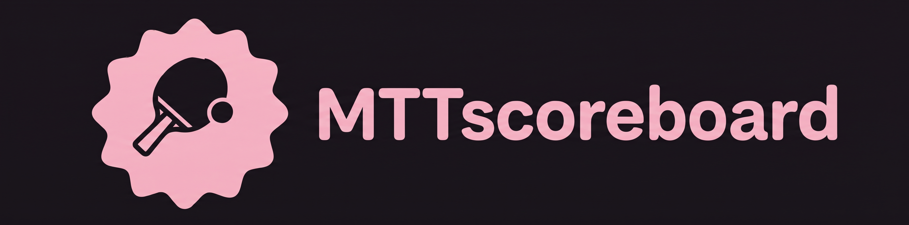
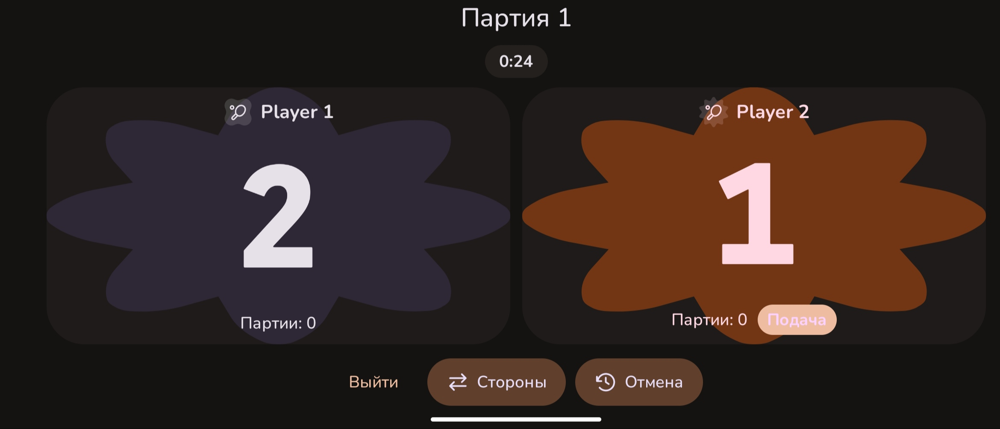

[Русский](README.ru.md)

# ScoreBoard



An offline table tennis scoreboard for Android 8.0+.

- Track points, games, and service in singles matches. Undo points and pick up where you left off.
- Use the scoreboard in portrait or landscape with custom colors, fonts, timers, and optional English or Russian announcements.
- Keep match history on your device, back it up as JSON, and share results as images.

**[Download APK](https://github.com/Pum3l0/MTTscoreboard/releases)** · [All screenshots](artwork/screenshots) · [GPL-3.0](LICENSE)



## Build

With JDK 17 and Android SDK 37 installed, open the project in Android Studio or run:

```sh
./gradlew :app:assembleDebug :app:testDebugUnitTest
```

By [Pum3l0](https://pumelo.site) · [Release guide](RELEASING.md)
