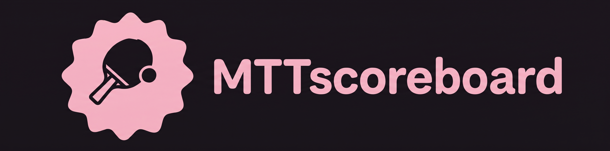
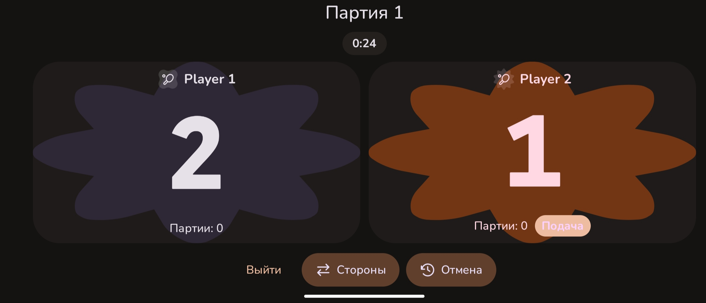
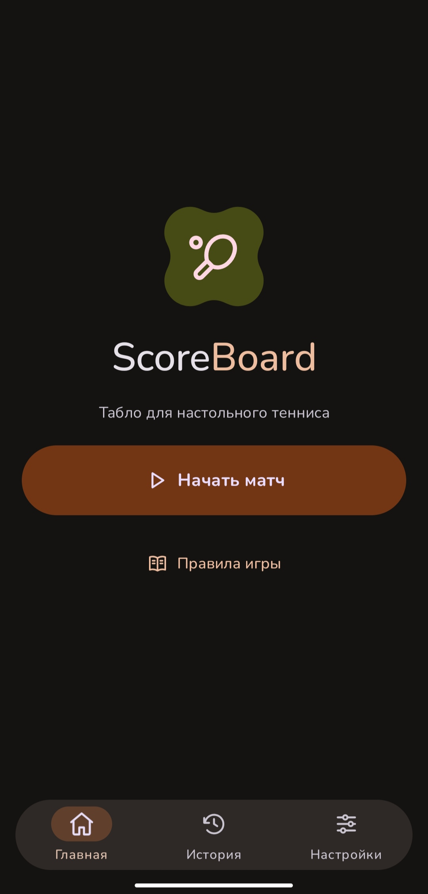
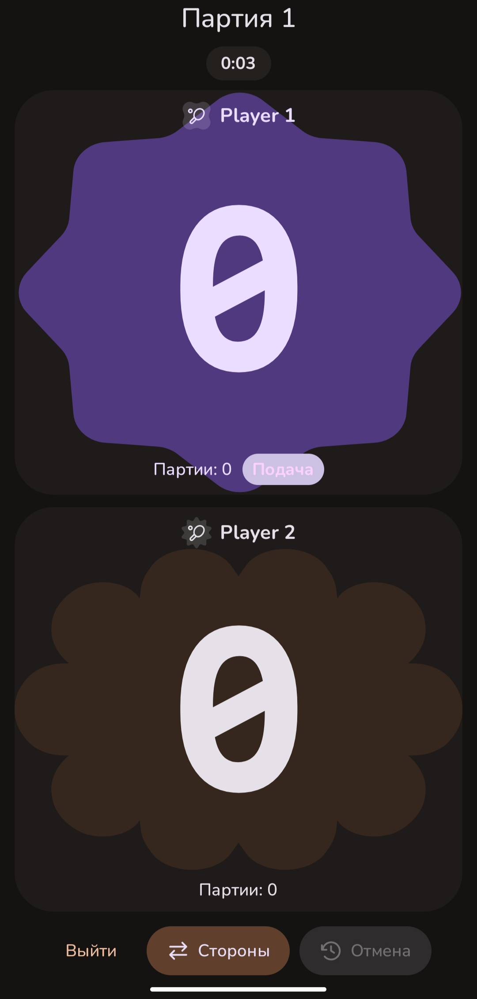
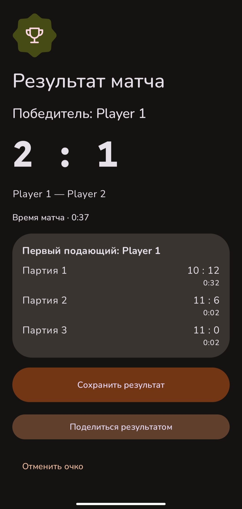
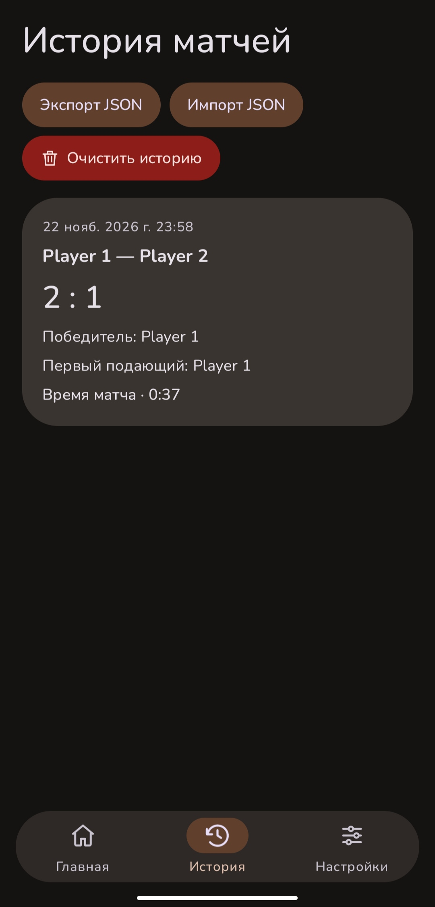

[English](README.md)

# ScoreBoard



Офлайн-табло для настольного тенниса на Android 8.0 и новее.

- Веди счёт, следи за партиями и подачей в одиночных матчах. Отменяй очки и продолжай незаконченные матчи.
- Используй табло в любой ориентации. Настраивай цвета, шрифты, таймеры и озвучку на русском или английском.
- Храни историю на устройстве, сохраняй резервную копию в JSON и делись результатом картинкой.

**[Скачать APK](https://github.com/Pum3l0/MTTscoreboard/releases)** · [Все скриншоты](artwork/screenshots) · [GPL-3.0](LICENSE)

## Скриншоты

<p align="center">
  
</p>

<p align="center">
  
  
  
  
</p>

## Сборка

С установленными JDK 17 и Android SDK 37 открой проект в Android Studio или запусти:

```sh
./gradlew :app:assembleDebug :app:testDebugUnitTest
```

Автор [Pum3l0](https://pumelo.site)
